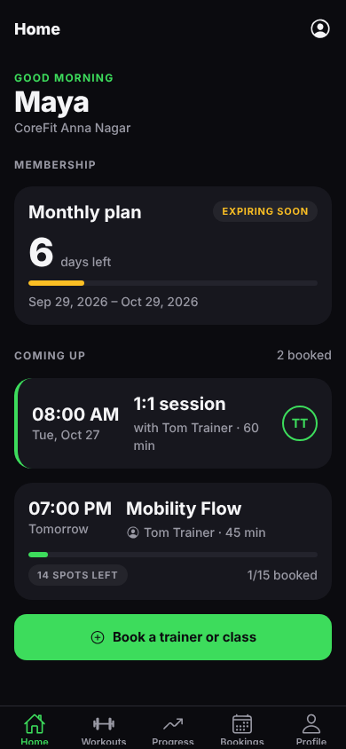
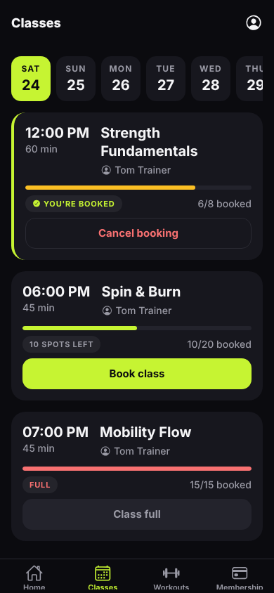
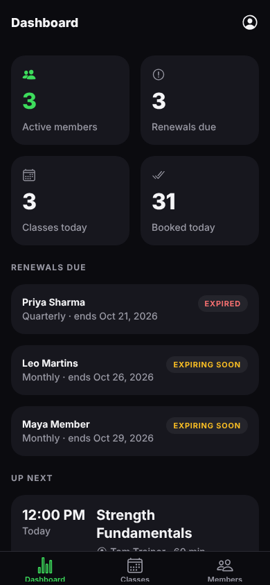

# CoreFit


A React Native app for gym members, trainers and owners. One app, three roles: each user
lands in their own area after signing in.

People can belong to several gyms and hold a different role in each (say, a trainer at one branch
and a member at another). The app shows one gym at a time and switches area with the role.

| Role    | What they can do today                                                   |
| ------- | ------------------------------------------------------------------------ |
| Member  | Membership, workouts, book trainers 1:1 and group classes, cancel either |
| Trainer | 1:1 sessions and classes on one schedule, mark sessions done, workouts   |
| Owner   | Dashboard with renewals due, the class timetable, members and plans      |

<p>
  
  
  
</p>

## Design

The product plan is in [docs/product-plan.pdf](docs/product-plan.pdf).

Dark-first with the CoreFit green accent and large (52pt) tap targets, since people use gym apps mid-workout
in dim light. Class booking follows the common timetable pattern: a horizontal day picker, then
rows showing time, trainer and live spots left with a fill bar. Tokens live in
`src/constants/theme.ts`.

## Stack

- **Expo SDK 58** with **Expo Router** (file-based routes, protected per role)
- **TypeScript** (strict)
- **TanStack Query** for server state, **Zustand** for the auth session
- **Supabase** for auth and Postgres, with row-level security per gym and role
- **Jest** + **React Native Testing Library**, ESLint (`eslint-config-expo`), Prettier

## Getting started

```bash
npm install
npm start          # then press i, a or w
```

In development (and EAS `preview` builds) without Supabase credentials the app runs on in-memory
demo data, and the sign-in screen lets you continue as a member, trainer or owner.

To use a real backend, copy `.env.example` to `.env`, fill in your project's URL and anon key,
and apply the schema:

```bash
npx supabase link --project-ref <your-ref>
npx supabase db push
```

New sign-ups get a `member` profile with no gym. Set `gym_id` and `role` on `profiles` to put
someone in a gym or make them a trainer or owner.

## Releasing

See [docs/RELEASE.md](docs/RELEASE.md) for EAS build profiles and the App Store / Play Store
checklist.

## Exercise library seed

`supabase/seed.sql` loads the shared exercise library. It's generated from
`src/features/exercises/library.ts` (also the demo data) with `node scripts/generate-exercise-seed.js`.

## Database checks

`supabase/tests/rls.sql` exercises the RLS policies and booking rules (double-booking, availability,
cross-gym access). On plain Postgres 16:

```bash
createdb corefit_test
psql -d corefit_test -f supabase/tests/plain-postgres-auth-stub.sql
for f in supabase/migrations/*.sql; do psql -d corefit_test -f "$f"; done
psql -d corefit_test -f supabase/tests/rls.sql
```

## Scripts

| Command             | What it does              |
| ------------------- | ------------------------- |
| `npm start`         | Start the Expo dev server |
| `npm test`          | Run Jest                  |
| `npm run typecheck` | `tsc --noEmit`            |
| `npm run lint`      | ESLint via `expo lint`    |
| `npm run format`    | Prettier                  |

## Project structure

```
src/
  app/                    Routes (Expo Router). Every file is a screen.
    _layout.tsx           Providers and role guards
    sign-in.tsx
    member/               Member tabs: home, classes, workouts, membership
    trainer/              Trainer tabs: schedule (1:1 sessions and classes), workouts
    book-trainer/         Member: pick a trainer's slot and book
    workout-session.tsx   Member: the workout in progress (sets, reps, rest timer)
    exercise/             Exercise detail, shared by members and trainers
    owner/                Owner tabs: dashboard, classes, members
  features/
    auth/                 Session store, sign-in/out, profile
    workouts/             types, api, hooks, components, tests
    bookings/             classes, class bookings, booking rules
    trainers/             trainer profiles, availability slots, 1:1 sessions
    exercises/            exercise library, search and filters
    progress/             workout logs, offline draft, streaks and personal records
    memberships/          plans, memberships, status rules
  components/             Shared UI (Screen, Card, Button, QueryState, tabs)
  lib/                    Supabase client, query client, env, formatting, mock data
  constants/ hooks/       Theme tokens and theme hooks
supabase/migrations/      Database schema and RLS policies
```

Each feature keeps the same shape: `types.ts` for the domain model, `api.ts` for Supabase calls
(mapping snake_case rows to camelCase types, with a mock fallback), `hooks.ts` for React Query
hooks and keys, pure business rules in `rules.ts`, and its own `components/`.
