# CoreFit Gym


A React Native app for gym members, trainers, supervisors and owners. One app, four roles: each
user lands in their own area after signing in.

People can belong to several gyms and hold a different role in each (say, a trainer at one branch
and a member at another). The app shows one gym at a time and switches area with the role.

| Role       | What they can do today                                                                                                                                                                                  |
| ---------- | ------------------------------------------------------------------------------------------------------------------------------------------------------------------------------------------------------- |
| Member     | Membership, assigned and gym plans, log workouts (works offline), progress and PRs, book trainers 1:1 and classes; see their trainers and ask the gym for one                                           |
| Trainer    | Build plans and assign them to their matched members, follow those members' progress, set weekly bookable hours, schedule their own classes, 1:1 sessions; inbox for nudges from the gym                |
| Supervisor | The owner's second-in-command: see and record payments and renewals, invite members and trainers, match members with one or more trainers, answer trainer requests, follow classes and message trainers |
| Owner      | Invite people by email, change roles, suspend or remove access; set up membership plans, schedule weekly classes, record cash or UPI payments and renewals; dashboard with renewals due                 |

Staff roles nest, so a small gym can run without a supervisor or trainer: owners can do all
supervisor and trainer work, and supervisors can do trainer work. Owners and supervisors coach
under **Training → Coaching** (bookable hours, 1:1 sessions, their classes, plans and members),
can be picked as a member's trainer, and get the same workout pushes a trainer would.

<p>
  
  
  
</p>
<p>
  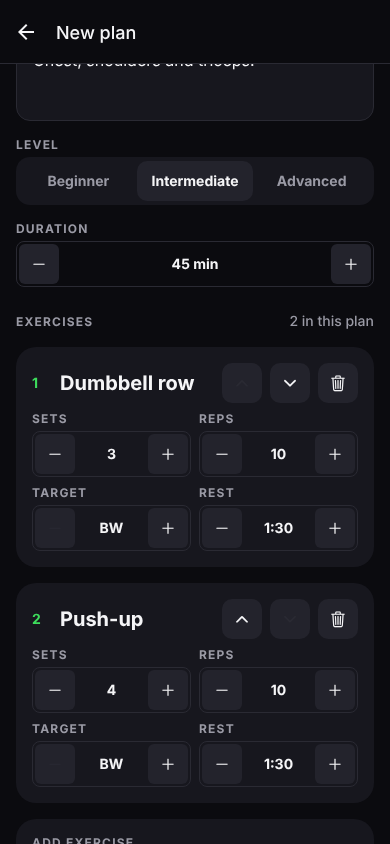
  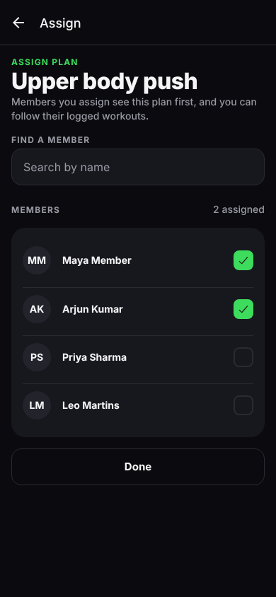
  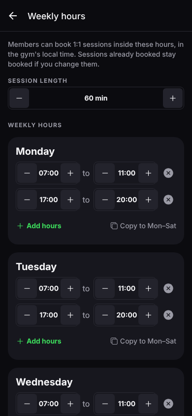
</p>
<p>
  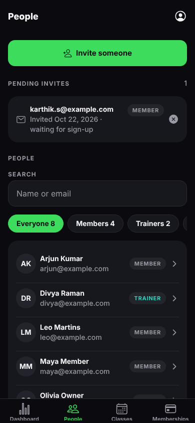
  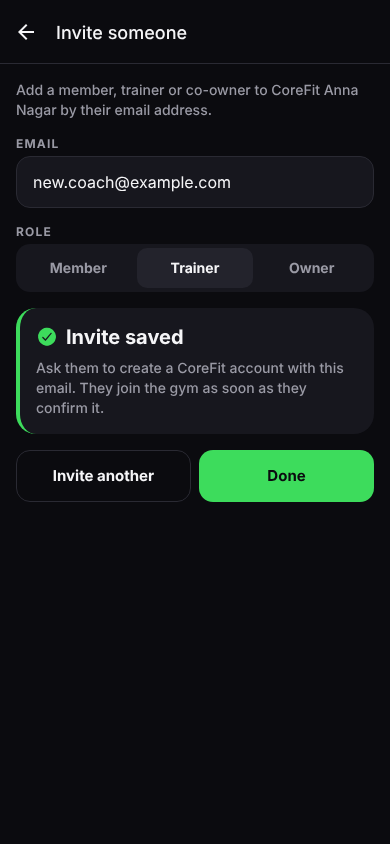
  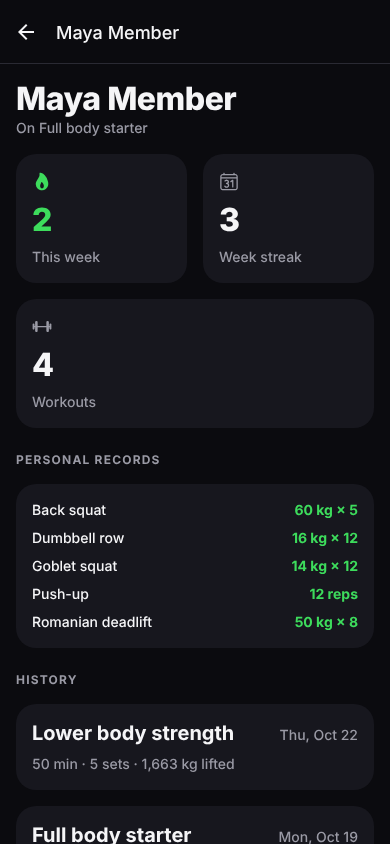
</p>
<p>
  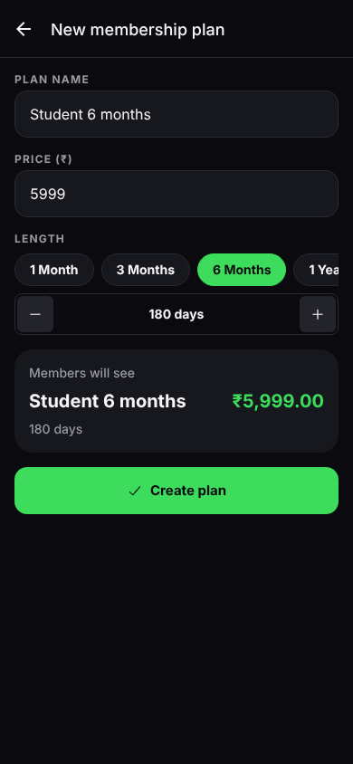
  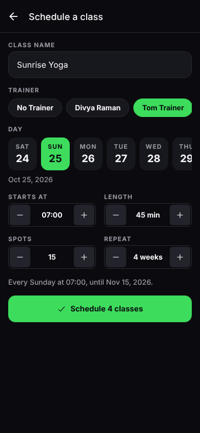
  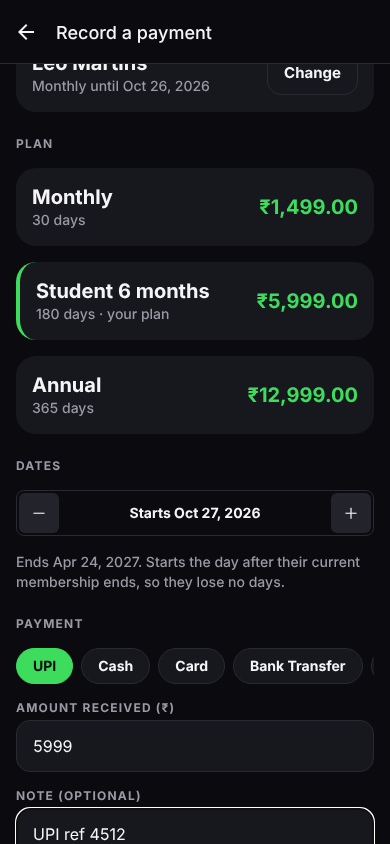
</p>
<p>
  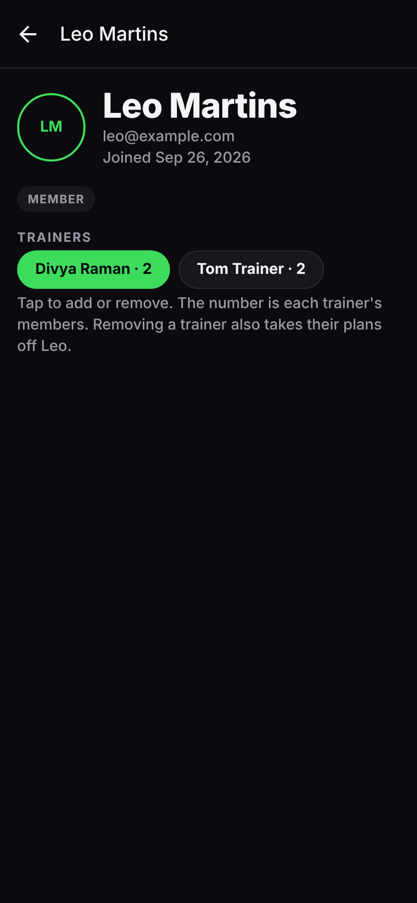
  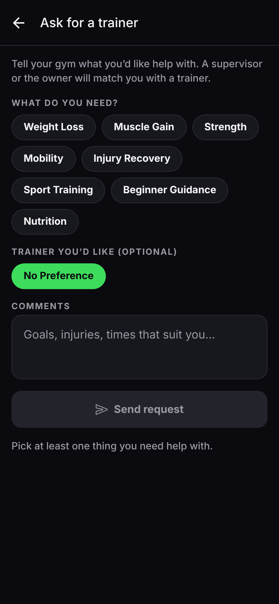
  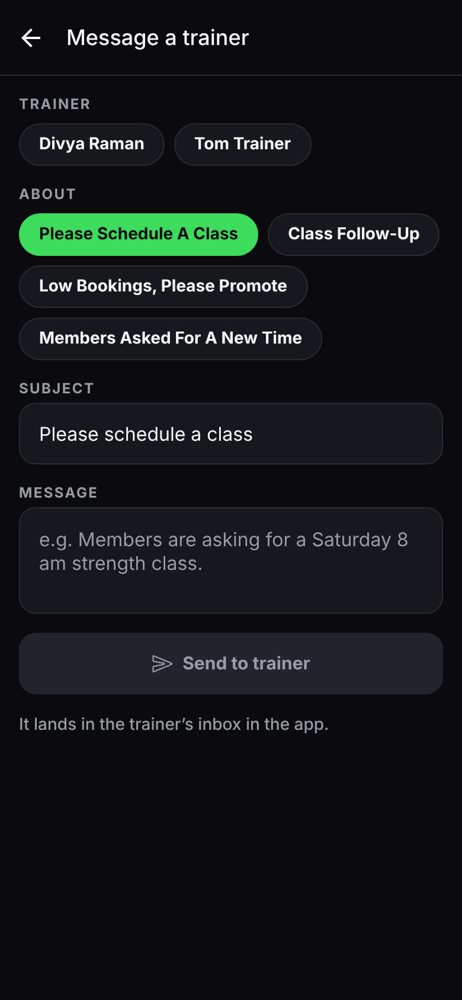
</p>

## Design

The product plan is in [docs/product-plan.pdf](docs/product-plan.pdf).

Dark-first with the CoreFit green accent and large (52pt) tap targets, since people use gym apps mid-workout
in dim light. Class booking follows the common timetable pattern: a horizontal day picker, then
rows showing time, trainer and live spots left with a fill bar. Tokens live in
`src/constants/theme.ts`.

## Stack

- **Expo SDK 58** with **Expo Router** (file-based routes, protected per role)
- **TypeScript** (strict)
- **TanStack Query** for server state, **Zustand** for the auth session
- **Supabase** for auth and Postgres, with row-level security per gym and role
- **Jest** + **React Native Testing Library**, ESLint (`eslint-config-expo`), Prettier

## Getting started

```bash
npm install
npm start          # real sign-in against CoreFit's Supabase project; press i, a or w
npm run demo       # built-in demo data, pick a role instead of signing in
```

The app talks to CoreFit's Supabase project by default (the URL and anon key are public client
values in `src/lib/env.ts`). For a different project, set `EXPO_PUBLIC_SUPABASE_URL` and
`EXPO_PUBLIC_SUPABASE_ANON_KEY` in `.env` (see `.env.example`), then apply the schema:

```bash
npx supabase link --project-ref <your-ref>
npx supabase db push
```

Then run `supabase/seed.sql` in the SQL editor to load the shared exercise library, and deploy the
functions:

```bash
npx supabase functions deploy delete-account   # account deletion (store requirement)
npx supabase functions deploy invite-member    # emails invites from the People tab
npx supabase functions deploy import-members   # member import from a CSV
npx supabase functions deploy accept-invite    # joining with a WhatsApp invite code
npx supabase functions deploy join --no-verify-jwt   # the tappable join link in WhatsApp invites
npx supabase functions deploy send-push --no-verify-jwt   # push notifications, see below
npx supabase functions deploy create-payment                # online payments, see below
npx supabase functions deploy razorpay-webhook --no-verify-jwt
npx supabase functions deploy create-subscription-payment   # owners paying CoreFit Gym
```

A new gym's first owner is added in SQL:

```sql
insert into gyms (name) values ('CoreFit Anna Nagar') returning id;
insert into gym_members (gym_id, user_id, role) values ('<gym id>', '<user id>', 'owner');
```

### Inviting people and signing in

Owners invite people from **People** by email and pick their role. Supervisors can invite
members and trainers; only owners add supervisors and owners.

- Someone with a CoreFit Gym account joins straight away.
- Anyone else gets an invite email with a code and a link. They enter the code in the app (or tap
  the link on their phone), choose their name and a password, and land on their role's screens. They can also just **Create an account** with that
  email instead.
- **Forgot password?** on the sign-in screen emails a link to the same set-password screen.

After sign-in the app opens only the screens for the person's role at their gym (owner,
supervisor, trainer or member). Role changes and suspensions apply the next time the app comes to the foreground.

Supabase settings these emails need (Dashboard → Authentication):

1. **URL Configuration → Redirect URLs:** add `corefit://**` (installed builds) and `exp://**`
   (Expo Go during development). Set **Site URL** to `corefit://`.
2. **Emails → SMTP Settings:** turn on custom SMTP (Resend, Brevo, SendGrid, Amazon SES or your
   domain's mail). Supabase's built-in sender only emails members of your Supabase team and
   about 2 emails an hour, so invites to anyone else fail without it.
3. **Emails → Templates:** paste the branded templates from `supabase/templates/` (each file's
   first line names the template and its subject): `invite.html` into **Invite user**,
   `recovery.html` into **Reset password** and `confirmation.html` into **Confirm signup**. They
   show the CoreFit logo, the gym, the role and a code.

Every one of these emails has a code as well as a link. The link only opens the app on a phone
that has it; the code works anywhere: on the sign-in screen tap **Got a code by email? Enter it**.

### Push notifications

Everything that lands in the inbox is also pushed to the person's phones, and tapping it opens the
inbox (switching to that gym if they belong to several):

| When                                   | Who hears                                                  |
| -------------------------------------- | ---------------------------------------------------------- |
| A class starts within the hour         | Booked members, and the trainer with the head count        |
| A 1:1 session starts within the hour   | The member and the trainer                                 |
| A class is moved or cancelled          | Booked members, and the trainer if someone else changed it |
| A 1:1 session is booked or cancelled   | The trainer when booked; whoever didn't cancel it          |
| A membership is recorded               | The member                                                 |
| A membership ends in 7, 3, 1 or 0 days | The member (from 9 am gym time, skipped if they renewed)   |
| A membership ended yesterday           | The member (from 9 am, skipped if they renewed)            |
| A membership enters its last week      | Owners and supervisors, with who ends this week            |
| A membership ends today                | Owners and supervisors (same morning push)                 |
| Staff tap Remind on a renewal          | The member (once a day at most)                            |
| Trainer messages, requests and matches | As before (PR #14)                                         |

How it works: the app saves each phone's Expo push token (`push_tokens`, via
`register_push_token`). A statement trigger on `notifications` posts new ids through `pg_net` to
the `send-push` edge function, which sends them with Expo's push service and drops tokens that
Expo reports as `DeviceNotRegistered`. Reminders come from `send_reminders()`, which pg_cron runs
every five minutes; each reminder has a dedupe key so it's sent once.

One-time setup:

1. `npx supabase db push` (enables `pg_cron` and `pg_net` and schedules the reminders job).
2. Pick a random secret (`openssl rand -hex 32`) and give it to both sides:

   ```bash
   npx supabase secrets set PUSH_WEBHOOK_SECRET=<secret>
   npx supabase functions deploy send-push --no-verify-jwt
   ```

   then in the SQL editor:

   ```sql
   select vault.create_secret('https://<project-ref>.supabase.co', 'project_url');
   select vault.create_secret('<secret>', 'push_webhook_secret');
   ```

   Until both Vault secrets exist, the inbox works and nothing is pushed.

3. `npx eas-cli@latest init` if `app.json` has no `extra.eas.projectId` yet; push tokens need it.
4. **Android:** create a Firebase project, add an Android app with package `com.corefit.gym`,
   download `google-services.json` to the project root and add
   `"googleServicesFile": "./google-services.json"` under `expo.android` in `app.json`. Then upload
   an FCM V1 service account key with `npx eas-cli@latest credentials` (Android → production →
   Push Notifications: FCM V1). **iOS:** `eas build` offers to create the APNs key; say yes.
5. Optional: turn on **Enhanced security for push notifications** in your Expo account and set the
   access token with `npx supabase secrets set EXPO_ACCESS_TOKEN=<token>`.

Where you can test it:

- **Expo Go on Android:** no push at all (removed in SDK 53). The inbox, bell and all the new
  inbox messages still work; Account → Push notifications explains why it's off.
- **Expo Go on iOS:** pushes work after `eas init`, but use a development build for anything you
  ship.
- **Development build** (`npx eas-cli@latest build --profile development`) or **preview/production
  builds** on a real phone: everything, including taps opening the inbox. Simulators and emulators
  can't get push tokens.

To check the server side without a phone, insert a reminder-like row for yourself in the SQL editor
(`select public.notify('<gym id>', '<your user id>', 'message', 'Test push', 'Hello');`) and
look at **Edge Functions → send-push → Logs**; `select * from net._http_response order by id desc
limit 5;` shows what `pg_net` got back.

### Online payments (Razorpay)

Members can pay for a plan in the app when the CoreFit Gym admin switches **Online payments** on
for their branch (Admin → branch → Online payments). It's a paid add-on per branch
(`platform_settings.online_addon_cents`, ₹6,000 a year by default) and off by default. Cash and UPI
entries at the front desk keep working.

How a payment works:

1. **Pay** on a plan (Profile) or **Renew now** (Home, when a membership is ending) calls
   `create-payment`, which creates a Razorpay payment link and opens it in the in-app browser. UPI,
   cards and netbanking work there, so there's no Razorpay SDK and no new build.
2. Razorpay calls `razorpay-webhook` (`payment_link.paid`), signed with the webhook secret.
   `complete_online_payment()` then records the membership with method `online`, starting the day
   after the current one ends, so it shows in Payments, Insights and exports. The member gets the
   usual "Membership active" push and owners and supervisors get "Online payment received".
3. The browser comes back through `razorpay-webhook` (GET, signed with the key secret), which sends
   it to `corefit://payment-return`; the app shows the payment's status and then its receipt.
4. If the branch has the owner's Route linked account (`acc_...`), the gym's share is transferred
   to it. Razorpay takes its Route transfer fee (0.25% + GST) from our balance on top of the
   transfer, so the transfer is the most that leaves room for it after Razorpay's gateway fee and
   CoreFit Gym's cut (`online_cut_bps`, 0.5%). Money never stays with CoreFit Gym. With
   live keys, a branch without a linked account can't take payments.

Who pays Razorpay's fees is set per branch (Admin → branch → Online payments). By default the
owner does: members see one price, and Razorpay's gateway fee (2% + GST), its transfer fee (0.25% +
GST) and CoreFit Gym's 0.5% cut come out of what the owner receives. A ₹1,000 plan nets the owner
₹968.53, so owners raise their prices to cover the fees if they want to. A branch can instead pass
the fees and the cut on to members: `create-payment` adds them to the price and the app shows the
member the breakdown before opening Razorpay. Either way the membership, Insights and exports count
the plan's price. The math is in
`supabase/functions/_shared/fees.ts` (tested in `src/features/payments/__tests__/fees.test.ts`).
If Razorpay gives the account other rates, set them as secrets (basis points, 100 = 1%):

```bash
npx supabase secrets set RAZORPAY_GATEWAY_FEE_BPS=200 RAZORPAY_TRANSFER_FEE_BPS=25 RAZORPAY_FEE_GST_PERCENT=18
```

Setup:

```bash
npx supabase secrets set RAZORPAY_KEY_ID=rzp_test_xxx RAZORPAY_KEY_SECRET=xxx
npx supabase secrets set RAZORPAY_WEBHOOK_SECRET=<a long random string>
npx supabase functions deploy create-payment
npx supabase functions deploy razorpay-webhook --no-verify-jwt
```

In the Razorpay dashboard, add a webhook at `https://<project-ref>.supabase.co/functions/v1/razorpay-webhook`
with the same secret and the events `payment_link.paid`, `payment_link.expired` and
`payment_link.cancelled`. Test cards and UPI IDs (`success@razorpay`) are in Razorpay's test mode
docs.

## Releasing

See [docs/RELEASE.md](docs/RELEASE.md) for EAS build profiles and the App Store / Play Store
checklist.

## Owner web dashboard

`web/` is a browser dashboard for gym owners: overview, members, payments, attendance and CSV
exports. It signs in with the same accounts and reads the same Supabase RLS and RPCs as the app.
See [web/README.md](web/README.md).

## Exercise library seed

`supabase/seed.sql` loads the shared exercise library. It's generated from
`src/features/exercises/library.ts` (also the demo data) with `node scripts/generate-exercise-seed.js`.
When you add exercises, also pass a new migration path
(`node scripts/generate-exercise-seed.js supabase/migrations/<timestamp>_<name>.sql`) so `supabase db push`
loads them into existing projects; the insert skips rows that already exist. Every library exercise
needs two demo frames in `assets/exercises/<id>/` and an entry in `src/features/exercises/demos.ts`.

## Database checks

`supabase/tests/rls.sql` exercises the RLS policies and booking rules (double-booking, availability,
cross-gym access). On plain Postgres 16:

```bash
createdb corefit_test
psql -d corefit_test -f supabase/tests/plain-postgres-auth-stub.sql
for f in supabase/migrations/*.sql; do psql -d corefit_test -f "$f"; done
psql -d corefit_test -f supabase/tests/rls.sql
psql -d corefit_test -f supabase/tests/workout-plans.sql
psql -d corefit_test -f supabase/tests/online-payments.sql
psql -d corefit_test -f supabase/tests/qr-check-in.sql
psql -d corefit_test -f supabase/tests/profiles.sql
psql -d corefit_test -f supabase/tests/import-members.sql
psql -d corefit_test -f supabase/tests/invite-codes.sql
psql -d corefit_test -f supabase/tests/subscriptions.sql
```

## Scripts

| Command             | What it does              |
| ------------------- | ------------------------- |
| `npm start`         | Start the Expo dev server |
| `npm run web`       | Start the owner dashboard |
| `npm test`          | Run Jest                  |
| `npm run typecheck` | `tsc --noEmit`            |
| `npm run lint`      | ESLint via `expo lint`    |
| `npm run format`    | Prettier                  |

## Project structure

```
src/
  app/                    Routes (Expo Router). Every file is a screen.
    _layout.tsx           Providers and role guards
    sign-in.tsx
    member/               Member tabs: home, classes, workouts, membership
    trainer/              Trainer tabs: schedule (1:1 sessions and classes), workouts
    book-trainer/         Member: pick a trainer's slot and book
    workout-session.tsx   Member: the workout in progress (sets, reps, rest timer)
    exercise/             Exercise detail, shared by members and trainers
    owner/                Owner tabs: dashboard, people, classes, memberships
    supervisor/           Supervisor tabs: the owner's dashboard, people and payments, plus classes
  features/
    auth/                 Session store, sign-in/out, profile
    workouts/             types, api, hooks, components, tests
    bookings/             classes, class bookings, booking rules
    trainers/             trainer profiles, availability slots, 1:1 sessions
    exercises/            exercise library, search and filters
    progress/             workout logs, offline draft, streaks and personal records
    memberships/          plans, memberships, status rules
    coaching/             member-to-trainer mapping and trainer requests
    notifications/        in-app inbox and messages to trainers
  components/             Shared UI (Screen, Card, Button, QueryState, tabs)
  lib/                    Supabase client, query client, env, formatting, mock data
  constants/ hooks/       Theme tokens and theme hooks
supabase/migrations/      Database schema and RLS policies
```

Each feature keeps the same shape: `types.ts` for the domain model, `api.ts` for Supabase calls
(mapping snake_case rows to camelCase types, with a mock fallback), `hooks.ts` for React Query
hooks and keys, pure business rules in `rules.ts`, and its own `components/`.
